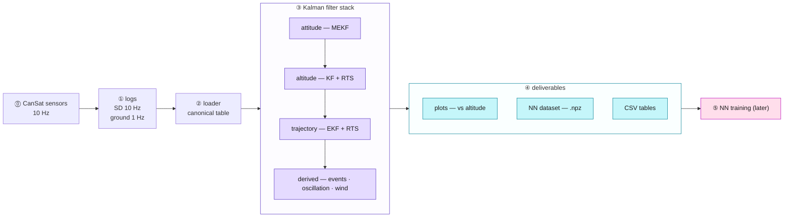
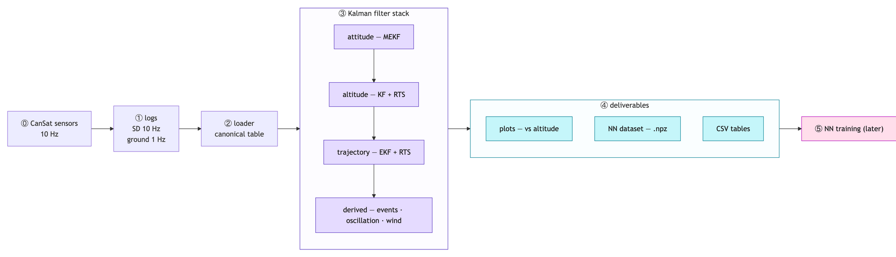

# CanSat offline analysis — system architecture (input → output)

> **What this is**: one diagram + tables explaining the post-flight data
> system in [`analysis/`](.) — from the raw sensor log on the microSD card to
> filtered data, plots and a neural-network training set.  Everything here is
> **offline Python** (the SD card is read after landing); the filter designs
> are the ones in [`docs/KALMAN-NOISE.md`](../docs/KALMAN-NOISE.md), which
> DATA-PIPELINE.md §6 planned.

## 1. The pipeline, input → output




**Read it as**: sensors → logs → loader → the Kalman stack (purple, each
filter feeds the next) → deliverables (cyan) → NN training.  The full detail
of every stage is in the tables below.




**Read it as**: green = sensors → orange = log files → red = canonical loader →
purple = the filter stack (each filter feeds the next: attitude → altitude →
trajectory) → cyan = the three deliverable families → pink = NN training.
The KF stack replaces nothing onboard: firmware still logs raw 10 Hz data and
the SD copy is the single source of truth (a telemetry drop can't lose it).

## 2. What gets filtered and what doesn't

| Data | Filter | Why |
|---|---|---|
| baro altitude + accel-z | ★ linear KF `[h, v, b]` + RTS | noisy integrating signal; v is the product |
| gyro + accel + mag | ☆ MEKF `[δθ, δ_bg]` | quaternion kinematics are nonlinear; bias drifts |
| GNSS + baro + accel (3-D) | ☆ EKF `[p, v, δθ, δ_ba]` + RTS | dead-reckoning drifts; GNSS 1 Hz is too sparse alone |
| T, RH, CO₂, O₃, UV, IR, lux, radiation, battery, health | **no filter** — bin/median/despike | slow science channels; a KF would only add lag (§6.1 verdict) |

Offline-only superpowers used here (impossible onboard): the **RTS smoother**
runs the flight backwards so every estimate uses future samples too; the
altitude filter consumes the **smoothed attitude** to rotate accel into the
vertical (correct at any tilt, not just near-vertical); the trajectory filter
carries σ_a,eff = √(σ_a² + g²·P_θθ) — attitude uncertainty rotating accel.

## 3. Data products

| Artifact | Producer | Contents |
|---|---|---|
| `<log>_altkf.csv` | `kalman.py altitude` | t, raw baro, h/v forward + smoothed, accel bias, σ |
| `<log>_attitude.csv` | `kalman.py attitude` | quaternion, roll/pitch/yaw, gyro bias, σ_tilt, raw gyro |
| `<log>_traj.csv` | `kalman.py trajectory` | NED position/velocity, smoothed h, σ_p/σ_v, σ_a,eff |
| `<log>_events.csv` | `kalman.py events` | launch/apogee/deploy/landing times |
| `plots/` PNGs | `plot_flight.py` | every channel vs KF altitude + compulsory altitude-time + overview sheet |
| `<log>_dataset.npz` | `nn_dataset.py` | `X_env_seq [T,C_env]` atmosphere inputs, labels `y_alt` (exact, m) + `y_band` (50 m class), `X_win_env [N,C_env,W]` windows + `X_seq`/`X_seq_raw` (all 63 channels), `mu`/`std`, chronological splits — **every §2 raw channel (incl. lat/lon/health/seq) and every per-sample §3 quantity** |
| `<log>_flat.csv` / `_metadata.json` | `nn_dataset.py` | flat table for pandas / channel order, stats, coverage, phase legend |
| `<log>_{profile,radiation,dh,lapse,oscillation,wind}.csv` | `nn_dataset.py` | the binned §3 tables, co-located so one folder trains everything |

NN dataset conventions (documented in the metadata JSON): the model input
is the atmospheric composition (14 environment-science channels; pressure
excluded as a leak — it is an altimeter) and the labels are **altitude**,
both exact (`y_alt`, metres, from the KF-smoothed h) and banded (`y_band`,
50 m classification classes); channels-first windows `[N, C, W]` (transpose
for TF/Keras), z-score normalisation with stats shipped in the file,
chronological train/val/test split before windowing (no leakage).

## 4. Commands

```bash
python3 analysis/kalman.py altitude   SD_LOG.csv --csv out/   # ★ h, v + RTS
python3 analysis/kalman.py attitude   SD_LOG.csv --csv out/   # ☆ MEKF
python3 analysis/kalman.py trajectory SD_LOG.csv --csv out/   # ☆ EKF+RTS
python3 analysis/kalman.py events     SD_LOG.csv              # flight timeline
python3 analysis/plot_flight.py SD_LOG.csv --out plots/       # all vs altitude
python3 analysis/nn_dataset.py  SD_LOG.csv --out nn/          # NN-ready set
.venv/bin/python -m pytest analysis/test_kalman.py -q         # accuracy suite
```

## 5. Design decisions worth knowing

- **Filter order matters**: attitude → altitude → trajectory.  The altitude
  filter's control input `u = −((R(q)ᵀ f)_z + g)` needs the quaternion; the
  trajectory filter needs both (initial attitude + per-step gyro bias).
- **Zero-order-hold alignment**: the sample at t is treated as the input over
  `[t, t+dt)` — every filter applies input `k−1` over the interval ending at
  `k`, matching how the firmware samples.  Without this, each flight-phase
  boundary injects a one-sample acceleration error (~±3.6 m/s in boost).
- **Offline σ_a = 0.5 m/s²**, not the doc's 0.05: the online value protects
  the filter through chute snatch; the smoother holds the whole record and
  can afford sharper phase transitions (v RMSE 0.08 m/s vs 0.99 on the
  synthetic flight — see `test_kalman.py`).
- **Rank-2 measurement noise**: the gravity-direction update has no
  information along the field direction (R_acc is rank 2 by design) — the
  gain needs `pinv` + a tiny regulariser along the null direction, or the
  round-off blows up and corrupts the gyro-bias estimate.
- **Unphysical truth transitions** (sim deploys the chute and lands with an
  *instant* 10 m/s Δv): any smooth process model smears such steps over
  ±1–2 s — that is correct behaviour, and the accuracy metrics exclude those
  grace windows rather than pretending otherwise.
- **GNSS altitude is re-referenced** to the baro pad-zero frame by the median
  GNSS−baro Δh before it enters the trajectory filter (MSL vs AGL mismatch).
- Firmware `alt_m` is sea-level-referenced (bmp581.c); every filter works
  **AGL** after subtracting the pre-launch pad mean.

## 6. Glossary

| Term | Meaning |
|---|---|
| KF | Kalman filter — recursive estimator that fuses a motion model with noisy measurements, optimally for linear systems |
| EKF | extended KF — for nonlinear models, linearised at each step |
| MEKF | multiplicative EKF — estimates a small attitude *error* instead of the quaternion itself |
| RTS smoother | Rauch–Tung–Striebel backward pass — re-reads the estimates backwards so each one also uses future measurements (offline only) |
| Q / R / P | process-noise / measurement-noise / state-uncertainty covariance matrices |
| δθ, δ_bg | small-angle attitude error (rad) and gyro-bias error (rad/s) |
| NED | north-east-down axes (z positive downward) |
| AGL | above ground level (pad-zeroed altitude) |
| ZOH | zero-order hold — input constant over each sample interval |
| GNSS | global navigation satellite system (GPS here) |
| MSL | mean sea level (GNSS altitude reference) |
| σ_a,eff | effective accel noise √(σ_a² + g²·P_θθ): attitude error rotates accel into the nav frame |
| CEP | circular error probable — GNSS horizontal accuracy radius |
| TC offset | BMP581 temperature-coefficient offset (baro drift with temperature) |
| ARW | angle random walk — gyro noise integrated into attitude drift |
