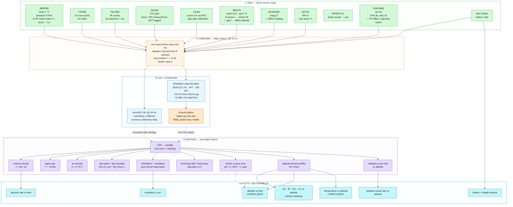

# CanSat — Data Pipeline Diagram

> **What this is**: one diagram + three tables showing the full data path — **what we collect RAW** (direct sensor output, exactly what `flight_frame_t` carries), **what is DERIVED** (calculated onboard vs post-flight in Python), and **what we must PLOT** for the PDR / competition rules.

> [!update] Changelog
> **2026-11-07b** — formula-only estimators implemented in `analysis/` (see the note under §3); the filter/fusion quantities stay with the §6 online/estimation work.
> **2026-11-07** — cleanup pass: consistent naming (`rh_pct`, `sht_temp_c`), SHT45 polling folded into `sht45_poll()`, §6 KF split added.
> **2026-11-06** — the four PDR gaps wired in: `src/bmi270.c` (+ the 8 KB `bmi270_config_file.c` blob from Bosch's BSD-licensed API), `src/mlx90395.c`, `src/sht45.c`, `src/rad_counter.c` (PB10 EXTI pulse counter). Health bitmask is 11 bits (`uint16_t`). Build passes (`pio run`, 56.5 KB flash / 2.7 KB RAM). Downlink JSON carries accel/gyro/RH/pulses-per-second; SD keeps everything at 10 Hz. LoRa at **250 kHz** so the ~247 B packet fits the 253 B SF7 payload cap.

## 1. The pipeline

**Read it as**: green = RAW (what a sensor hands us directly) → orange = fused 10 Hz frame → blue/red = two independent data paths (SD copy + radio downlink) → purple = DERIVED (computed, never measured) → cyan = PLOTS. **★/☆ = needs a Kalman filter (§6)** — ★ runs online on the STM32, ☆ post-flight in Python; unmarked channels need no KF (bin/median only).

## 2. RAW data — what we can actually collect today

Exactly the fields in [`src/telemetry.h`](../src/telemetry.h), logged at 10 Hz to SD, downlinked at 1 Hz as JSON:

| Field | JSON key | Sensor | Units | Rate | Notes |
|---|---|---|---|---|---|
| Timestamp | `t` | MCU clock | ms | 10 Hz / 1 Hz | shared clock — time sync solved |
| Packet number | `n` | — | — | 1 Hz | lets ground count lost packets |
| Temperature | `T` | BMP280 | °C | 1 Hz | **primary mission** |
| Pressure | `P` | BMP280 | hPa | 1 Hz | **primary mission** |
| Altitude | `A` | BMP280 (derived) | m | 1 Hz | computed onboard from P |
| UV | `uv` (`uvi` SD-only) | LTR390 | counts, UVI | 1 Hz | |
| IR / light | `ir`, `full`, `lux` | TSL2591 | counts, lux | **SD-only** | downlink fits `uv` instead |
| CO₂ | `co2` | SCD30 | ppm | 1 Hz | SCD30 also gives T + RH — not logged |
| Ozone | `o3` | O3-B4 | ppb | 1 Hz | differential ADC, needs calibration |
| Accel | `ax`, `ay`, `az` | BMI270 | m/s² | 1 Hz | ±2 g range, ★ KF process input |
| Gyro | `gx`, `gy`, `gz` | BMI270 | °/s | 1 Hz | ±2000 dps, ☆ offline attitude |
| Magnetometer | `mx`, `my`, `mz` | MLX90395 | µT | **SD-only** | verify µT/LSB scale at bring-up |
| Humidity | `rh` (`rh_pct` SD) | SHT45 | % | 1 Hz | plus `sht_temp_c`, SD-only |
| Radiation | `rad` | BPW34 S-Z | pulses/s | 1 Hz | PB10 EXTI counter, latched at 1 Hz |
| GPS | `la`, `lo`, `ga`, `s` | SAM-M8Q | deg, m, count | 1 Hz | recovery + drift/wind proxy |
| Battery | `v` | ADC divider | V | 1 Hz | housekeeping |
| Health bitmask | `h` | — | bits | 1 Hz | bits 0..10: BMP, LTR, TSL, SCD, GPSdata, GPSfix, SD, BMI, MLX, SHT, RAD |

Rates come from [`src/config.h`](../src/config.h): `SAMPLE_PERIOD_MS = 100` (onboard logging), `TELEMETRY_PERIOD_MS = 1000` (primary mission downlink).

## 3. DERIVED data — what we calculate

| Quantity | Formula | Inputs | Computed where | Status |
|---|---|---|---|---|
| Altitude | $h=\tfrac{T_0}{L}\left(1-\left(\tfrac{P}{P_0}\right)^{RL/(gM)}\right)$ | P, T | onboard (already in frame) | ✅ done |
| Vertical velocity (descent rate) | $v=\Delta h/\Delta t$ — central difference + median filter | h, t | post-flight (★ online KF planned, §6) | ✅ easy |
| Air density | $\rho=\tfrac{P}{R_s T}$, $R_s=287.05$ J/kg·K | P, T | post-flight | ✅ easy |
| Temperature lapse rate | $\Gamma=-\,\mathrm{d}T/\mathrm{d}z$ | T, h | post-flight | ✅ easy |
| Dew point | $\gamma=\ln\tfrac{RH}{100}+\tfrac{aT}{b+T},\;T_d=\tfrac{b\gamma}{a-\gamma}$ | `sht_temp_c`, `rh_pct` | post-flight | ✅ SHT45 in frame |
| Absolute humidity | $AH=216.7\,\tfrac{e_s}{T+273.15}$ g/m³, $e_s=\tfrac{RH}{100}\cdot 6.112\,e^{17.62T/(243.12+T)}$ | `sht_temp_c`, `rh_pct` | post-flight | ✅ SHT45 in frame |
| Orientation roll/pitch/yaw | sensor fusion (Mahony/Madgwick / EKF) | accel, gyro, mag | post-flight ☆ | ✅ data in frame |
| Descent oscillation frequency | FFT of angular rate | `gyr_*` | post-flight | ✅ data in frame |
| 3D trajectory | fuse GNSS + inertial + baro (EKF + RTS smoother) | IMU, GPS, P | post-flight ☆ | ✅ data in frame |
| Horizontal drift / wind proxy | Δlat/Δlon per altitude bin vs expected descent | GPS | post-flight | ✅ possible now |
| GNSS vs baro altitude error | $\Delta h=h_{GNSS}-h_{baro}$ | `ga`, `A` | post-flight | ✅ easy |
| Altitude-binned profiles | mean of each sensor per 50 m altitude bin | all | post-flight | ✅ core science step |
| Radiation count rate | counts/s vs altitude | `rad_cps` | post-flight | ✅ counter in frame |
| Ozone from mV | $C_{ppb}=(I_{work}-I_{aux})/S$ | ADC counts | post-flight (needs cal curve) | ⚠ needs O3-B4 calibration |
| Parachute deployment time | detect Δv discontinuity | accel + v | post-flight | ✅ accel now available |

**Formula plug-ins (2026-11-07)** — the pure-formula rows are scripts in [`../analysis/`](../analysis/README.md): `atmosphere_estimator.py` (ρ, Γ, dew point, AH), `profile_estimator.py` (50 m bins, radiation rate ± sem, GNSS−baro Δh), `ozone_estimator.py` (mV→ppb with the cal JSON); each is importable *and* a CLI, tested in `test_estimators.py`. The rows that need a filter or fusion (velocity re-filter, orientation, 3D trajectory, wind proxy, deploy detection) are part of the online/estimation work (§6) and deliberately not scripted here.

## 4. PLOTS — what the PDR + rules expect

| Plot | Axes | Source fields | Required by |
|---|---|---|---|
| Altitude vs time | h (m) vs t (s) | `A`, `t` | **compulsory** (2026-27 rules) |
| Temperature vs altitude | T (°C) vs h (m) | `T`, `A` | **compulsory** (2026-27 rules) |
| Descent rate vs time | v (m/s) vs t | derived v | secondary — validates chute sizing |
| Science heatmap | UV / IR / CO₂ / O₃ binned vs altitude | `uv`, `ir`, `co2`, `o3`, `A` | secondary mission deliverable |
| GNSS vs baro Δh | Δh (m) vs t | `ga`, `A` | data sanity / calibration evidence |
| Oscillation vs time | ω vs t | `gyr_*` | PDR secondary list |
| Radiation count rate vs altitude | counts/s vs h | `rad_cps` | PDR secondary list |
| Battery + health timeline | V, bitmask vs t | `v`, `h` | power budget evidence |

> **Rule reminder** (verified 2026-10-09): telemetry **once per second** (done — `TELEMETRY_PERIOD_MS = 1000`), frequency must be **alterable** and UK-legal (done — LoRa 433 MHz @ 10 dBm). GPS is **not** part of the compulsory mission.

## 5. PDR ↔ firmware gaps — resolved 2026-11-06, wired into the firmware

1. **Sensor-list mismatch** — BMI270, MLX90395, SHT45 and the BPW34 chain are now implemented. Still to do at submission: the PDR text should name the real suite (BMP280, not BMP581).
2. **Humidity dropped** — superseded: dedicated SHT45 feeds `rh_pct` + `sht_temp_c` into the frame; dew point / absolute humidity unblocked.
3. **IMU quantities blocked** — BMI270 (accel + gyro) and MLX90395 (heading) wired; orientation / oscillation / trajectory fusion unblocked.
4. **Secondary-mission story conflict** — firmware now covers both the UV/IR/CO₂/O₃ profiling suite and radiation counting; the PDR text still needs to pick the framing.

**Still outstanding**: PCB routing for the four new parts + comparator front end (WIRING.md §2 and §4), bench bring-up (nothing hardware-verified yet), MLX90395 µT/LSB scale + O3-B4 calibration checks on hardware.

## 6. Kalman filter — which channels need one, and online vs offline (2026-11-07)

**Rule of thumb**: a KF earns its keep only where a *noisy rate/integrating signal* (accel, gyro, baro h, GNSS) must be fused into a **state that software acts on or that drifts when integrated**. Slow science channels get 50 m-bin means / median despiking post-flight — a KF there wastes RAM and hides real excursions.

### 6.1 Per-channel verdict

| Raw field (`flight_frame_t`) | Sensor | KF? | Where | What the KF does |
|---|---|---|---|---|
| `pressure_hpa` → `altitude_m` | BMP280 | ✅ **yes** | **online** ★ | 3-state `[h, v, b]` baro KF: P-derived h @ 10 Hz as measurement, accel-z as process input → clean `h` + `v` for the descent state machine |
| `acc_x/y/z` | BMI270 | ✅ yes — as the *process input* | **online** ★ (z-axis only) | bridges velocity between baro samples; also launch / apogee / chute-deployment detection |
| `gyr_x/y/z` | BMI270 | ✅ yes | **offline** ☆ | attitude fusion (Mahony/Madgwick or EKF) → roll/pitch/yaw + oscillation FFT |
| `mag_x/y/z` | MLX90395 | ✅ yes | **offline** ☆ | heading channel in the same attitude fusion |
| `gps_lat/lon`, `gps_alt_m` | SAM-M8Q | ✅ yes | **offline** ☆ | 3D-trajectory EKF + RTS smoother (GNSS + baro + inertial); also the GNSS-vs-baro Δh plot. Optional cheap online add-on: GPS-alt as a slow correction re-anchoring baro drift |
| `rh_pct`, `sht_temp_c` | SHT45 | ❌ no | — | slow science channel — 50 m-bin mean is the deliverable |
| `temp_c` (as science T) | BMP280 | ❌ no | — | lapse-rate plot uses raw T; only the *altitude* derived from P needs the KF |
| `uv_raw`, `uv_index` | LTR390 | ❌ no | — | bin + report |
| `ir_counts`, `full_counts`, `lux` | TSL2591 | ❌ no | — | bin + report |
| `co2_ppm` | SCD30 | ❌ no | — | SCD30 already internally averages; a second filter only adds lag |
| `o3_ppb` | O3-B4 | ❌ no | — | needs the calibration curve, not a filter; median despike at most |
| `rad_cps` | BPW34 | ❌ no | — | Poisson counting — widen the count window, don't KF |
| `vbat_v` | ADC | ❌ no | — | housekeeping |

### 6.2 The online/offline split

**ONLINE — exactly one small KF, and only because flight software *acts* on its output.**
The 4× spoiler servos (`config.h` TIM8) are actuated from measured descent rate, and the descent state machine needs h/v for phase detection (apogee, chute-out, petal-brake control, landing → power-down). So a 3-state `[h, v, accel-bias]` baro+accel KF runs on the G474 at 10 Hz — ~20 flops/step, trivial for the M4F @ 170 MHz. It overwrites `altitude_m` and (new) feeds `v` to the state machine.

> **Update 2026-11-07**: the petal/fin brake system is archived — the competition descent is chute-only at ~10 m/s ( statically stable, no descent-control hardware; see the vault note `Cansat — Static margin stability`). The KF itself stays (altitude + `v` feed the apogee/landing detection), but the petal-brake servo trigger is on hold unless the brake is revived.

**OFFLINE — everything judge-facing**, possible because SD logs RAW @ 10 Hz independently of the 1 Hz downlink:
- attitude EKF/Madgwick (gyro+accel+mag) → orientation + oscillation plots
- GNSS+baro+inertial trajectory EKF, then an **RTS smoother** — offline's superpower: it uses *future* samples too, so it beats anything the onboard KF can do
- optional re-filter of altitude with tuned Q/R for the compulsory altitude-vs-time plot

**Deliberately NOT onboard**: attitude EKF (the petal brake is altitude/rate-based, not attitude-based) and GNSS fusion (recovery doesn't need smoothed position in flight). Keeps the firmware simple and the health bitmask honest.

> **Keep logging RAW** @ 10 Hz to SD — every offline KF/smoother is only possible because the SD copy carries unfiltered fields. Never log only filtered data.

See also: [`README.md`](../README.md) · [`WIRING.md`](../WIRING.md) · [`data.md`](../data.md)
