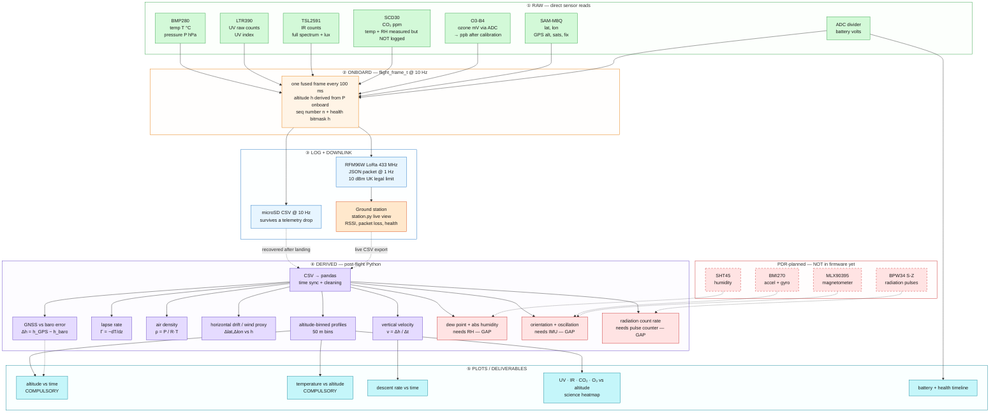

# CanSat — Data Pipeline Diagram

> **What this is**: one diagram + three tables showing the full data path — **what we collect RAW** (direct sensor output, exactly what `flight_frame_t` carries), **what is DERIVED** (calculated onboard vs post-flight in Python), and **what we must PLOT** for the PDR / competition rules. Cross-checked against the team PDR plan — gaps are flagged in red.

## 0. Update — 2026-11-06: the four gaps are wired in

> [!update] BMI270 · MLX90395 · SHT45 · BPW34 are now **in the firmware**
> New drivers: `src/bmi270.c` (+ the 8 KB `bmi270_config_file.c` blob from
> Bosch's BSD-licensed API), `src/mlx90395.c`, `src/sht45.c`,
> `src/rad_counter.c` (PB10 EXTI pulse counter). `flight_frame_t` carries
> acc/gyr/mag/rh_pct/sht_temp_c/rad_cps; the health bitmask is 11 bits wide
> (`uint16_t`). Build passes (`pio run`, 56.5 KB flash / 2.7 KB RAM).
> The sections below are the **historical pre-wiring record** — what still
> stands: **PCB routing + bench bring-up pending** (WIRING.md §2 and the
> new §4 checklist), MLX90395 µT/LSB scale and O3-B4 calibration to verify
> on hardware. Downlink JSON now carries accel/gyro/RH/pulses-per-second
> (SD keeps everything at 10 Hz); LoRa moved to **250 kHz** so the ~247 B
> packet fits the 253 B SF7 payload cap.

## 1. The pipeline

**Read it as**: green = RAW (what a sensor hands us directly) → orange = fused 10 Hz frame → blue/red = two independent data paths (SD copy + radio downlink) → purple = DERIVED (computed, never measured) → cyan = PLOTS. Red = PDR wants it but the firmware can't collect it yet.

## 2. RAW data — what we can actually collect today

Exactly the fields in [`src/telemetry.h`](../src/telemetry.h), logged at 10 Hz to SD, downlinked at 1 Hz as JSON:

| Field | JSON key | Sensor | Units | Rate | Notes |
|---|---|---|---|---|---|
| Timestamp | `t` | MCU clock | ms | 10 Hz / 1 Hz | shared clock — time sync solved |
| Packet number | `n` | — | — | 1 Hz | lets ground count lost packets |
| Temperature | `T` | BMP280 | °C | 1 Hz | **primary mission** |
| Pressure | `P` | BMP280 | hPa | 1 Hz | **primary mission** |
| Altitude | `A` | BMP280 (derived) | m | 1 Hz | computed onboard from P |
| UV | `uv`, `uvi` | LTR390 | counts, UVI | 1 Hz | |
| IR / light | `ir`, `full`, `lux` | TSL2591 | counts, lux | 1 Hz | |
| CO₂ | `co2` | SCD30 | ppm | 1 Hz | SCD30 also gives T + RH — **dropped**, see §5 |
| Ozone | `o3` | O3-B4 | ppb | 1 Hz | differential ADC, needs calibration |
| GPS | `la`, `lo`, `ga`, `s` | SAM-M8Q | deg, m, count | 1 Hz | recovery + drift/wind proxy |
| Battery | `v` | ADC divider | V | 1 Hz | housekeeping |
| Health bitmask | `h` | — | bits | 1 Hz | bit0 BMP … bit6 SD |

Rates come from [`src/config.h`](../src/config.h): `SAMPLE_PERIOD_MS = 100` (onboard logging), `TELEMETRY_PERIOD_MS = 1000` (primary mission downlink).

## 3. DERIVED data — what we calculate

| Quantity | Formula | Inputs | Computed where | Status |
|---|---|---|---|---|
| Altitude | $h=\tfrac{T_0}{L}\left(1-\left(\tfrac{P}{P_0}\right)^{RL/(gM)}\right)$ | P, T | onboard (already in frame) | ✅ done |
| Vertical velocity (descent rate) | $v=\Delta h/\Delta t$ — central difference + median filter | h, t | post-flight | ✅ easy |
| Air density | $\rho=\tfrac{P}{R_s T}$, $R_s=287.05$ J/kg·K | P, T | post-flight | ✅ easy |
| Temperature lapse rate | $\Gamma=-\,\mathrm{d}T/\mathrm{d}z$ | T, h | post-flight | ✅ easy |
| Horizontal drift / wind proxy | Δlat/Δlon per altitude bin vs expected descent | GPS | post-flight | ✅ possible now |
| GNSS vs baro altitude error | $\Delta h=h_{GNSS}-h_{baro}$ | `ga`, `A` | post-flight | ✅ easy |
| Altitude-binned profiles | mean of each sensor per 50 m altitude bin | all | post-flight | ✅ core science step |
| Ozone from mV | $C_{ppb}=(I_{work}-I_{aux})/S$ | ADC counts | post-flight (needs cal curve) | ⚠ needs O3-B4 calibration |
| Dew point | $\gamma=\ln\tfrac{RH}{100}+\tfrac{aT}{b+T},\;T_d=\tfrac{b\gamma}{a-\gamma}$ | T, RH | post-flight | ❌ **no RH in frame** |
| Absolute humidity | $AH=216.7\,\tfrac{e_s}{T+273.15}$ g/m³, $e_s=\tfrac{RH}{100}\cdot 6.112\,e^{17.62T/(243.12+T)}$ | T, RH | post-flight | ❌ **no RH in frame** |
| Orientation roll/pitch/yaw | sensor fusion (Mahony/Madgwick) | accel, gyro, mag | post-flight | ❌ **no IMU in firmware** |
| Descent oscillation frequency | FFT of angular rate | IMU | post-flight | ❌ no IMU |
| 3D trajectory | fuse GNSS + inertial + baro | IMU, GPS, P | post-flight | ❌ no IMU |
| Parachute deployment time | detect Δv discontinuity | accel + v | post-flight | ⚠ best-effort from baro only |
| Radiation count rate | counts/s vs altitude | BPW34 | post-flight | ❌ not in firmware |

## 4. PLOTS — what the PDR + rules expect

| Plot | Axes | Source fields | Required by |
|---|---|---|---|
| Altitude vs time | h (m) vs t (s) | `A`, `t` | **compulsory** (2026-27 rules) |
| Temperature vs altitude | T (°C) vs h (m) | `T`, `A` | **compulsory** (2026-27 rules) |
| Descent rate vs time | v (m/s) vs t | derived v | secondary — validates chute sizing |
| Science heatmap | UV / IR / CO₂ / O₃ binned vs altitude | `uv`, `ir`, `co2`, `o3`, `A` | secondary mission deliverable |
| GNSS vs baro Δh | Δh (m) vs t | `ga`, `A` | data sanity / calibration evidence |
| Battery + health timeline | V, bitmask vs t | `v`, `h` | power budget evidence |
| Oscillation vs time | ω vs t | IMU — blocked | PDR secondary list |
| Radiation count rate vs altitude | counts/s vs h | BPW34 — blocked | PDR secondary list |

> **Rule reminder** (verified 2026-10-09): telemetry **once per second** (done — `TELEMETRY_PERIOD_MS = 1000`), frequency must be **alterable** and UK-legal (done — LoRa 433 MHz @ 10 dBm). GPS is **not** part of the compulsory mission.

## 5. Gaps found while cross-checking PDR ↔ firmware

1. **Sensor-list mismatch**: the PDR plan names SHT45 / BMP581 / BMI270 / MLX90395 / BPW34 S-Z; the firmware flies BMP280 / LTR390 / TSL2591 / SCD30 / O3-B4 / SAM-M8Q. Primary mission is satisfied either way (T + P @ 1 Hz), but the **PDR text must be aligned to the real suite** before submission — judges check sensor claims against the block diagram.
2. **SCD30 temp + RH are measured but thrown away** — [`src/scd30.h`](../src/scd30.h) carries `temp_c` and `rh_pct`, but `flight_frame_t` only keeps `co2_ppm`. Adding two floats unlocks dew point, absolute humidity and humidity-vs-altitude for free.
3. **All IMU-derived PDR quantities are blocked** (orientation, oscillation, 3D trajectory fusion) — no BMI270 / MLX90395 in the firmware build.
4. **Radiation-counting secondary mission (PDR) ≠ atmospheric gas profiling (firmware)** — pick one story: either update the PDR secondary mission to UV/IR/CO₂/O₃ vs altitude, or add the BPW34 + comparator counting chain.

See also: [`README.md`](../README.md) · [`WIRING.md`](../WIRING.md) · [`data.md`](../data.md)
