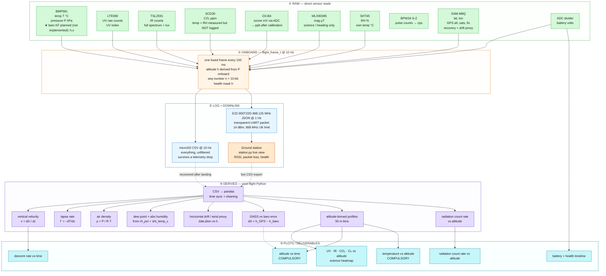

# CanSat — Data Pipeline Diagram

> **What this is**: one diagram + three tables showing the full data path — **what we collect RAW** (direct sensor output, exactly what `flight_frame_t` carries), **what is DERIVED** (calculated onboard vs post-flight in Python), and **what we must PLOT** for the PDR / competition rules.

> [!update] Changelog
> **2026-11-19** — hardware/status correction: BMP581 (SPI) replaces BMP280; E22-900T22D (UART, 868.125 MHz) replaces the RFM96W; **the BMI270 was removed — no IMU is fitted**, so MLX90395 + BMP581 are the only SPI sensors. **No KF/EKF is implemented in firmware**: §6 is a design plan only, and attitude/trajectory EKFs are not buildable without an IMU.
> **2026-11-08** — historical (no IMU fitted as of 2026-11-19): §6 labeled KF vs EKF: the planned online baro filter is a **linear KF** (no EKF, no Jacobians); **EKF only offline** — attitude (nonlinear quaternion kinematics; MEKF, or Madgwick as the easier non-KF route) and trajectory (EKF + RTS smoother = EKS).
> **2026-11-07b** — §3 formula plug-ins implemented in `analysis/` (`atmosphere_estimator.py`, `profile_estimator.py`, `ozone_estimator.py`). Means and differences only — no fits, filters or fusion; the filter/fusion rows stay with the §6 online work.
> **2026-11-07** — cleanup pass: consistent naming (`rh_pct`, `sht_temp_c`), SHT45 polling folded into `sht45_poll()`, §6 KF split added.
> **2026-11-06** — historical: the PDR gaps wired in at the time (including a BMI270 driver, since removed on 2026-11-19); `src/mlx90395.c`, `src/sht45.c`, `src/rad_counter.c` (PB10 EXTI pulse counter). Health bitmask is now 10 bits (`uint16_t`). Current build: ~45.5 KB flash / 2.8 KB RAM. Downlink JSON carries RH/pulses-per-second; SD keeps everything at 10 Hz. E22 transparent UART at **62.5 kbps**.

## 1. The pipeline

**Read it as**: green = RAW (what a sensor hands us directly) → orange = fused 10 Hz frame → blue/red = two independent data paths (SD copy + radio downlink) → purple = DERIVED (computed, never measured) → cyan = PLOTS. **★/☆ = needs a Kalman filter (§6)** — ★ linear KF planned (not implemented) on the STM32, ☆ EKF post-flight in Python; unmarked channels need no filter (bin/median only).

## 2. RAW data — what we can actually collect today

Exactly the fields in [`src/telemetry.h`](../src/telemetry.h), logged at 10 Hz to SD, downlinked at 1 Hz as JSON:

| Field | JSON key | Sensor | Units | Rate | Notes |
|---|---|---|---|---|---|
| Timestamp | `t` | MCU clock | ms | 10 Hz / 1 Hz | shared clock — time sync solved |
| Packet number | `n` | — | — | 1 Hz | lets ground count lost packets |
| Temperature | `T` | BMP581 | °C | 1 Hz | **primary mission** |
| Pressure | `P` | BMP581 | hPa | 1 Hz | **primary mission** |
| Altitude | `A` | BMP581 (derived) | m | 1 Hz | computed onboard from P |
| UV | `uv` (`uvi` SD-only) | LTR390 | counts, UVI | 1 Hz | |
| IR / light | `ir`, `full`, `lux` | TSL2591 | counts, lux | **SD-only** | downlink fits `uv` instead |
| CO₂ | `co2` | SCD30 | ppm | 1 Hz | SCD30 also gives T + RH — not logged |
| Ozone | `o3` | O3-B4 | ppb | 1 Hz | differential ADC, needs calibration |
| Magnetometer | `mx`, `my`, `mz` | MLX90395 | µT | **SD-only** | verify µT/LSB scale at bring-up; no attitude EKF (no IMU) |
| Humidity | `rh` (`rh_pct` SD) | SHT45 | % | 1 Hz | plus `sht_temp_c`, SD-only |
| Radiation | `rad` | BPW34 S-Z | pulses/s | 1 Hz | PB10 EXTI counter, latched at 1 Hz |
| GPS | `la`, `lo`, `ga`, `s` | SAM-M8Q | deg, m, count | 1 Hz | recovery + drift/wind proxy |
| Battery | `v` | ADC divider | V | 1 Hz | housekeeping |
| Health bitmask | `h` | — | bits | 1 Hz | bits 0..9: BMP581, LTR, TSL, SCD, GPSdata, GPSfix, SD, MLX90395, SHT45, RAD |

Rates come from [`src/config.h`](../src/config.h): `SAMPLE_PERIOD_MS = 100` (onboard logging), `TELEMETRY_PERIOD_MS = 1000` (primary mission downlink).

## 3. DERIVED data — what we calculate

| Quantity | Formula | Inputs | Computed where | Status |
|---|---|---|---|---|
| Altitude | $h=\tfrac{T_0}{L}\left(1-\left(\tfrac{P}{P_0}\right)^{RL/(gM)}\right)$ | P, T | onboard (already in frame) | ✅ done |
| Vertical velocity (descent rate) | $v=\Delta h/\Delta t$ — central difference + median filter | h, t | post-flight (★ online KF planned, §6) | ✅ `cansat_data.get_vel` |
| Air density | $\rho=\tfrac{P}{R_s T}$, $R_s=287.05$ J/kg·K | P, T | post-flight | ✅ `atmosphere_estimator.py` |
| Temperature lapse rate | $\Gamma=-\,\mathrm{d}T/\mathrm{d}z$ | T, h | post-flight | ✅ `atmosphere_estimator.py` |
| Dew point | $\gamma=\ln\tfrac{RH}{100}+\tfrac{aT}{b+T},\;T_d=\tfrac{b\gamma}{a-\gamma}$ | `sht_temp_c`, `rh_pct` | post-flight | ✅ `atmosphere_estimator.py` |
| Absolute humidity | $AH=216.7\,\tfrac{e_s}{T+273.15}$ g/m³, $e_s=\tfrac{RH}{100}\cdot 6.112\,e^{17.62T/(243.12+T)}$ | `sht_temp_c`, `rh_pct` | post-flight | ✅ `atmosphere_estimator.py` |
| Orientation roll/pitch/yaw | sensor fusion (Mahony/Madgwick / EKF) | accel, gyro, mag | — | ⬜ blocked: no IMU fitted |
| Descent oscillation frequency | FFT of angular rate | gyro | — | ⬜ blocked: no IMU fitted |
| 3D trajectory | fuse GNSS + inertial + baro (EKF + RTS smoother) | IMU, GPS, P | — | ⬜ blocked: no IMU fitted |
| Horizontal drift / wind proxy | Δlat/Δlon per altitude bin vs expected descent | GPS | post-flight | ✅ possible now |
| GNSS vs baro altitude error | $\Delta h=h_{GNSS}-h_{baro}$ | `ga`, `A` | post-flight | ✅ `profile_estimator.py` |
| Altitude-binned profiles | mean of each sensor per 50 m altitude bin | all | post-flight | ✅ `profile_estimator.py` |
| Radiation count rate | counts/s vs altitude | `rad_cps` | post-flight | ✅ `profile_estimator.py` |
| Ozone from mV | $C_{ppb}=(I_{work}-I_{aux})/S$ | ADC counts | post-flight (needs cal curve) | ⚠ `ozone_estimator.py` — needs O3-B4 calibration |
| Parachute deployment time | detect Δv discontinuity | baro h + v | post-flight | ⚠ no accel; use baro/GNSS Δv |

**Formula plug-ins (2026-11-07)** — the rows tagged with a script name above are implemented in [`../analysis/`](../analysis/README.md); each is importable *and* a CLI, numpy/pandas only, no scipy. Deliberately **formula-only — nothing in `analysis/` filters, fits, or holds state**: bins hold plain means, Γ = −ΔT/Δz between consecutive 50 m-bin mean temperatures (descent-only by default, so the pad and ground-rest clusters can't dominate the lowest bins), Δh is one subtraction, ozone is (mV − zero)/sens. The rows needing filtering or fusion (velocity re-filter, orientation, oscillation, 3D trajectory, wind proxy, deploy detection) are the §6 online/estimation work; the simple $v=\Delta h/\Delta t$ recipe lives in `cansat_data.get_vel`.

## 4. PLOTS — what the PDR + rules expect

| Plot | Axes | Source fields | Required by |
|---|---|---|---|
| Altitude vs time | h (m) vs t (s) | `A`, `t` | **compulsory** (2026-27 rules) |
| Temperature vs altitude | T (°C) vs h (m) | `T`, `A` | **compulsory** (2026-27 rules) |
| Descent rate vs time | v (m/s) vs t | derived v | secondary — validates chute sizing |
| Science heatmap | UV / IR / CO₂ / O₃ binned vs altitude | `uv`, `ir`, `co2`, `o3`, `A` | secondary mission deliverable |
| GNSS vs baro Δh | Δh (m) vs t | `ga`, `A` | data sanity / calibration evidence |
| Oscillation vs time | ω vs t | `gyr_*` | PDR secondary list |
| Radiation count rate vs altitude | counts/s vs h | `rad_cps` | PDR secondary list |
| Battery + health timeline | V, bitmask vs t | `v`, `h` | power budget evidence |

Each `analysis/` estimator writes plot-ready CSVs via `--csv DIR`: the binned profile feeds the science heatmap, `radiation_profile` the radiation plot, `gnss_baro_dh` the GNSS-vs-baro Δh plot.

> **Rule reminder** (verified 2026-10-09): telemetry **once per second** (done — `TELEMETRY_PERIOD_MS = 1000`), frequency must be **alterable** and UK-legal (E22 868.125 MHz @ 14 dBm). GPS is **not** part of the compulsory mission.

## 5. PDR ↔ firmware gaps — resolved 2026-11-06, wired into the firmware

1. **Sensor-list mismatch** — MLX90395, SHT45 and the BPW34 chain are implemented; the BMI270 was removed, so there is **no IMU**. Still to do at submission: the PDR text should name the real suite (BMP581).
2. **Humidity dropped** — superseded: dedicated SHT45 feeds `rh_pct` + `sht_temp_c` into the frame; dew point / absolute humidity unblocked.
3. **IMU quantities blocked** — no IMU is fitted; orientation / oscillation / inertial trajectory fusion are not possible. MLX90395 still provides heading.
4. **Secondary-mission story conflict** — firmware now covers both the UV/IR/CO₂/O₃ profiling suite and radiation counting; the PDR text still needs to pick the framing.

**Still outstanding**: PCB routing for the four new parts + comparator front end (WIRING.md §2 and §4), bench bring-up (nothing hardware-verified yet), MLX90395 µT/LSB scale + O3-B4 calibration checks on hardware.

## 6. Kalman filter — what is possible without an IMU

**No IMU is fitted.** Accel and gyro are not sampled, logged or transmitted, so
an attitude EKF (quaternion kinematics) or an inertial trajectory EKF cannot be
built. The only filter with a real job is the barometric altitude/velocity
filter.

**Rule of thumb**: a KF earns its keep only where a *noisy rate/integrating
signal* must be fused into a **state that software acts on or that drifts when
integrated**. Slow science channels get 50 m-bin means / median despiking
post-flight — a KF there wastes RAM and hides real excursions. The online baro
filter is fully linear → a plain KF, and simpler C.

### 6.1 Per-channel verdict

| Raw field (`flight_frame_t`) | Sensor | KF? | Where | What the KF would do (none implemented) |
|---|---|---|---|---|
| `pressure_hpa` → `altitude_m` | BMP581 | ✅ **planned KF (linear)** | **online** ★ | 3-state `[h, v, b]` baro KF: P-derived h @ 10 Hz as the only measurement → clean `h` + `v` for apogee/landing detection. No accelerometer input; process noise is unmodelled acceleration (tune on flight data). Linear (constant F/H) — **no EKF, no Jacobians** |
| `gps_lat/lon`, `gps_alt_m` | SAM-M8Q | ❌ no | — | recovery, horizontal drift and the GNSS-vs-baro Δh plot; optional slow GPS-alt correction of baro drift is a future linear add-on |
| `mag_x/y/z` | MLX90395 | ❌ no | — | science / heading only; attitude fusion needs accel + gyro |
| `rh_pct`, `sht_temp_c` | SHT45 | ❌ no | — | slow science channel — 50 m-bin mean is the deliverable |
| `temp_c` (as science T) | BMP581 | ❌ no | — | lapse-rate plot uses raw T; only the *altitude* derived from P needs the KF |
| `uv_raw`, `uv_index` | LTR390 | ❌ no | — | bin + report |
| `ir_counts`, `full_counts`, `lux` | TSL2591 | ❌ no | — | bin + report |
| `co2_ppm` | SCD30 | ❌ no | — | SCD30 already internally averages; a second filter only adds lag |
| `o3_ppb` | O3-B4 | ❌ no | — | needs the calibration curve, not a filter; median despike at most |
| `rad_cps` | BPW34 | ❌ no | — | Poisson counting — widen the count window, don't KF |
| `vbat_v` | ADC | ❌ no | — | housekeeping |

### 6.2 The online/offline split

**ONLINE — planned: one small *linear* KF, not implemented.**
The 4× spoiler servos (`config.h` TIM8) are ready, and a future descent state
machine would need h/v for phase detection (apogee, chute-out, landing →
power-down). The design is a 3-state `[h, v, b]` baro KF at 10 Hz — ~20
flops/step, trivial for the M4F @ 170 MHz. It would overwrite `altitude_m` and
feed `v` to the state machine. **This is not in `src/` today.**

> **Update 2026-11-07**: the petal/fin brake system is archived — the
> competition descent is chute-only at ~10 m/s (statically stable, no
> descent-control hardware; see the vault note `Cansat — Static margin
> stability`). The KF itself stays (altitude + `v` feed apogee/landing
> detection), but the petal-brake servo trigger is on hold unless the brake is
> revived.

**OFFLINE — judge-facing analysis only**, possible because SD logs RAW @ 10 Hz
independently of the 1 Hz downlink:
- altitude/descent-rate plots from baro + GNSS;
- GNSS-vs-baro Δh, horizontal drift / wind proxy, 50 m-binned science profiles;
- optional re-filter of altitude with tuned Q/R for the compulsory altitude-vs-time
  plot.

**Not possible without an IMU**: attitude EKF/Madgwick, oscillation FFT, and
inertial 3D-trajectory EKF/RTS. The firmware stays simple and the health
bitmask mirrors what is actually fitted.
